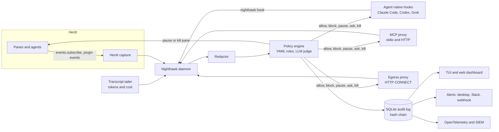

# Nighthawk

Agent observability and protection for [Herdr](https://github.com/herdrdev/herdr).
Nighthawk is a Herdr plugin written in Go. It watches every coding agent running
in your Herdr sessions (Claude Code, Codex, Grok Build, OpenCode and others),
records what they spend and what they touch, and blocks malicious actions when
nobody is watching.

> Status: M0–M3 are implemented in this tree. The daemon, hooks, policy,
> MCP proxy, egress proxy, audit log, TUI, local web UI, alerts, SIEM
> forwarding and cluster spend query are in the `nighthawk` binary.
> Linux nftables apply still needs a root Linux host. Live Herdr subscribe
> still needs Herdr 0.9.3. See the
> [roadmap issue](../../issues?q=is%3Aissue+label%3Aroadmap).

## Vision

Running agents unattended overnight is useful and risky. A single prompt
injection in a README, an issue comment or an MCP tool result can turn an agent
into an exfiltration tool. Nighthawk gives you one place to see what every agent
did, what it cost, and what it was stopped from doing, and it enforces a
fail-closed policy when you are away.

## Features

- **Spend:** tokens and cost per agent, session, task and model, parsed from agent
  hooks and transcripts.
- **MCP:** every MCP call (server, tool, arguments, result) through a stdio and
  streamable HTTP proxy that can allow or deny.
- **Network:** every outbound connection through an HTTP(S) egress proxy with a
  host allowlist.
- **Skills, commands and file writes:** from Claude Code `PreToolUse` and
  `PostToolUse` hooks, Codex configuration and Herdr pane events.
- **Protection:** a YAML policy engine with a default unattended ruleset.
  Actions are block, pause the pane, ask a human, or kill the session.
- **Detections:** curl piped to a shell, secret access, destructive commands,
  unknown egress, MCP tool list tampering, hook disabling, and an optional LLM
  judge for prompt injection.
- **Integrity:** a tamper-evident, hash-chained audit log in SQLite.
- **Interfaces:** a Herdr popup TUI, a local web dashboard, and alerts to the
  desktop, Slack or a webhook.
- **Exports:** OpenTelemetry, and SIEM forwarding (for example Wedgetail).
- **Cluster:** works with [herdr-sched-cluster](https://github.com/jusso-dev/herdr-sched-cluster)
  across machines.
- **Privacy:** secrets redacted before anything is stored or exported.

## Architecture



Herdr can observe panes and stop them, but it cannot intercept a tool call
before it runs. Blocking therefore happens at the agent hook, the MCP proxy and
the egress proxy. See [docs/ARCHITECTURE.md](docs/ARCHITECTURE.md).

## Quick start

Requirements: Herdr 0.9.3 or later, Go 1.26 or later, macOS or Linux.

```sh
git clone https://github.com/jusso-dev/nighthawk
cd nighthawk
go build ./... && go test ./...
herdr plugin link "$PWD"        # installs the plugin from this checkout
```

Then run the **Install Nighthawk hooks** action from the Herdr command palette,
and **Nighthawk: enter unattended mode** before you walk away.

## Documents

- [Architecture](docs/ARCHITECTURE.md)
- [Threat model](docs/THREAT-MODEL.md)
- [Decisions](docs/adr/)
- [CI template](docs/ci/ci.yml) (kept out of `.github/workflows` for now)

## Licence

MIT. See [LICENSE](LICENSE).
